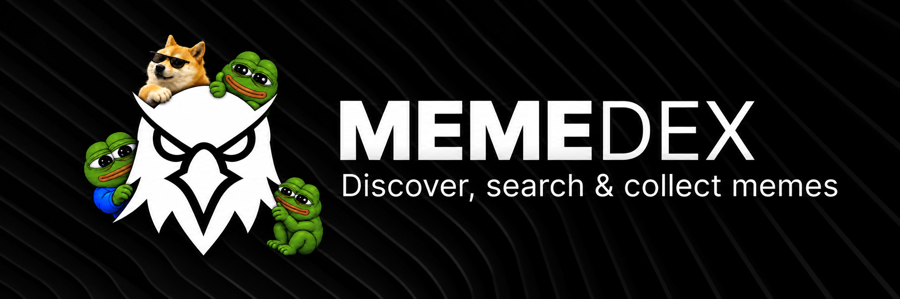

<p align="center">
  
</p>

**Your meme discovery terminal.** Search public sources, explore templates, and build a private meme library in your browser.

Memedex is a static web app. Search requests go from your browser to the configured public services. There is no Memedex account, analytics, or application server.

## What it does

- Search meme posts from Lemmy, Bluesky, Mastodon, and Reddit, plus Imgflip templates.
- Browse image, GIF, template, and combined search results. Sort results and filter by source.
- Open a result to visit its source, download or copy media, save it, find similar items, or caption a supported Imgflip template.
- Search by image with Memedex Lens.
- Keep a personal library in this browser: upload or save memes, add descriptions and tags, organize folders, and search with keywords or optional local embeddings.
- Generate image descriptions in the browser with Florence-2, or configure an OpenAI-compatible vision endpoint.
- Add your own API keys in Settings for optional Tenor, Giphy, and Imgur search. Keys are stored in this browser.

Search results and saved data have different storage: search results are fetched from their source, while uploaded and saved items stay in this browser unless you export them. External search providers receive the queries needed to return results. Review each provider's terms and privacy policy before use.

## Run locally

The app uses JavaScript modules and needs to be served over HTTP. Python 3 is sufficient:

```sh
python tools/serve.py
```

Then open http://127.0.0.1:8000. You can also use another static web server that serves JavaScript files with the correct MIME type.

## Project structure

```
index.html          App shell and entry point
css/                Application styles
js/app.js           Interface, navigation, settings, and actions
js/sources.js       Search source adapters
js/search.js        Search and local library ranking
js/store.js         Browser storage and library import/export
js/ai.js            Optional image descriptions and embeddings
data/memes.json     Bundled meme metadata and search index
memes/              Bundled meme images
assets/             Fonts, characters, and brand images
icons/              App icons
tools/serve.py      Local development server
tools/bump_version.py Cache version helper
```

## Hosting

Memedex is a static site and can be hosted by GitHub Pages or any static web host. Publish the contents of this repository as the site root. No build step or backend service is required. If you change cache-busted asset URLs in `index.html`, update their version values for the new release.

## Legal notices

This distribution contains third-party software, fonts, and example media. Their applicable license and attribution notices are provided in `LICENSE`, `NOTICE`, and the license files under `assets/fonts/`. Keep those notices with redistributed copies. Meme search results are provided by their respective platforms and link back to their sources.

